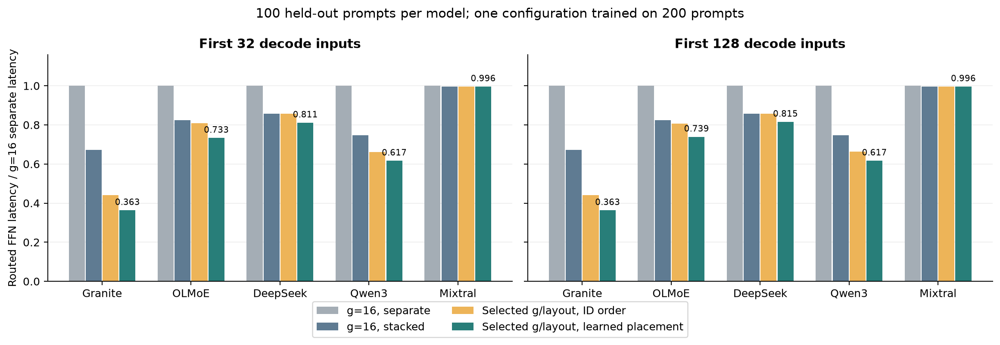
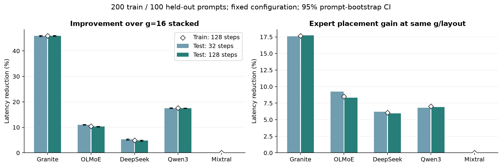
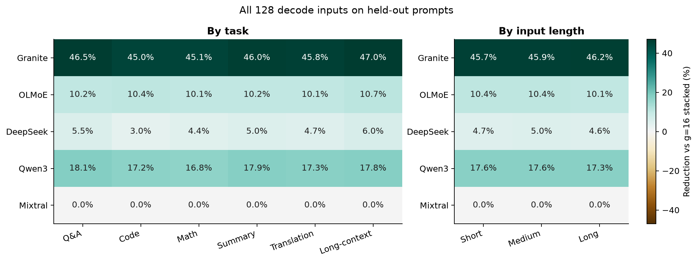
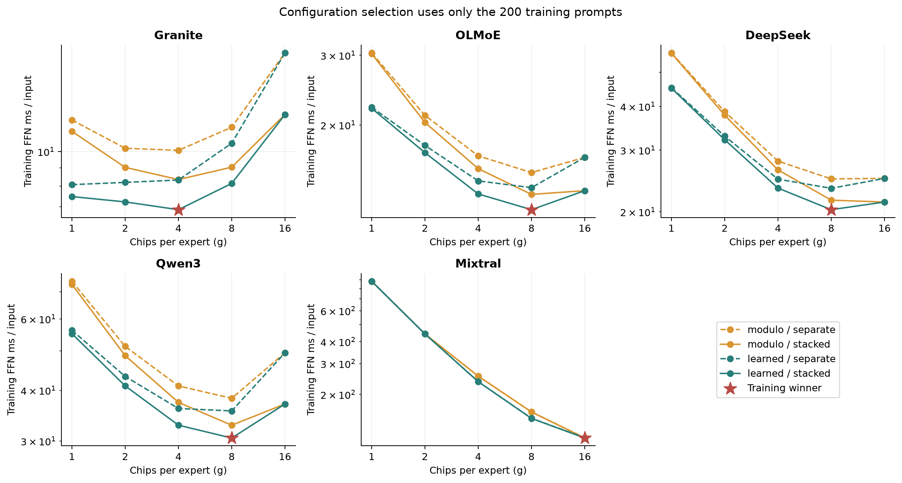
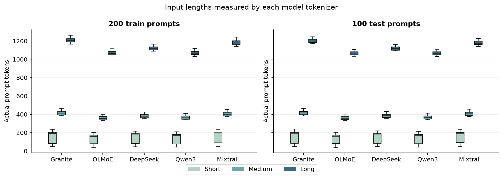
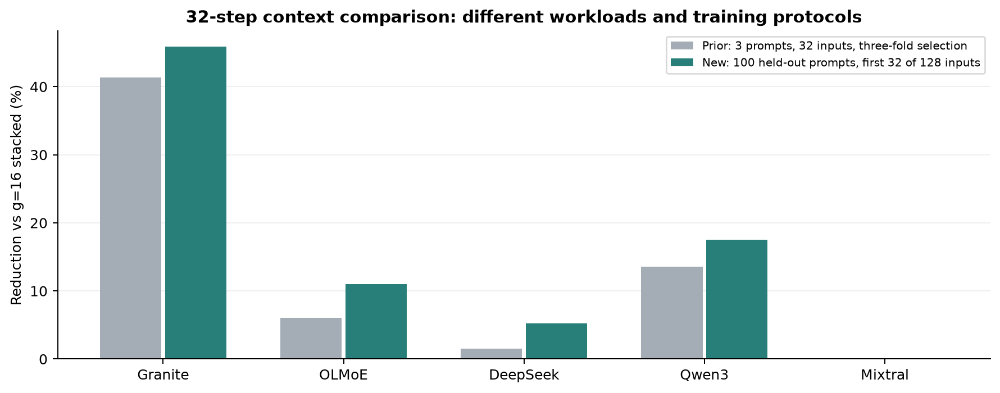

# 300-prompt 五模型固定配置實驗

五個模型各用同一組 300 題：200 題學習 expert 固定排列與選擇 g、gate/up 串接，100 題保留測試。每題執行 128 次實際 decode；前 32 步直接取自同一次執行。

題庫涵蓋問答、程式、數學、摘要、翻譯、長文理解，各 50 題；short／medium／long 共 104／100／96 題。題庫是本地編寫、可重現的合成工作負載，並非公開品質基準。訓練與測試情境 ID、名稱與數值分開；模板與部分題型共用，因此結論範圍是這組工作負載的新輸入。任務／長度分組是描述統計，各長度不保證相同子題型組成，不能當作純輸入長度的因果比較。

配置只依 200 題的完整 128 步選定。配置與 SHA-256 先寫入 `frozen_plan.json`，之後才讀入測試 routing 做評估；前 32 步與完整 128 步均使用相同配置。每層每個 g 執行 512 次固定種子的容量守恆 swaps；這是啟發式搜尋，不保證全域最優。

| 模型 | g | gate/up | 16-chip 串接基線 ms/input | 學習配置 ms/input | 改善（95% CI） | 相同 g/layout 的排列增益 |
|---|---:|---|---:|---:|---:|---:|
| Granite | 4 | 串接 | 12.7035 | 6.8712 | 45.91% (45.71–46.10%) | 17.74% |
| OLMoE | 8 | 串接 | 13.6484 | 12.2430 | 10.30% (10.18–10.41%) | 8.32% |
| DeepSeek | 8 | 串接 | 21.3327 | 20.3131 | 4.78% (4.56–4.99%) | 5.94% |
| Qwen3 | 8 | 串接 | 37.0237 | 30.5421 | 17.51% (17.39–17.62%) | 6.91% |
| Mixtral | 16 | 串接 | 112.8376 | 112.8376 | 0.00% (0.00–0.00%) | 0.00% |

信賴區間以整個 prompt 為抽樣單位、配對 bootstrap 2,000 次；同一題的 128 個 decode inputs 與各層不當作獨立樣本。輸出包含每題、每個 token、任務與輸入長度分組結果，並保留無改善或負改善。

所有 1,500 次 traced 推論各有一個完整 128 步 untraced greedy 對照，token IDs 與輸出 bytes 必須一致；每筆 routing 檢查 layer、token position、實際 token ID、expert 數量及範圍。Mixtral 使用 32 個獨立 sequence 的批次；其 untraced 對照從相同 prefill KV snapshot 啟動，再獨立執行全部 128 步。其他四模型使用 8 個 sequence 並各自重新 prefill。批次化會影響數值運算次序，因此不宣稱與舊單序列推論有逐位元相同的 routing。

向量化時序模型依每個 chip 的 expert 數量計算 flash、控制及向量傳輸；每個 g、layout、policy、layer 均與原始 scalar 模型核對，涵蓋六任務、三長度與第 1／32／128 步。

NVMeVirt 已涵蓋全部 100 題測試輸入：每模型固定學習配置與 16-chip 串接基線各一套，分成 prefix32 與 tail96，共 20 個配置／步段核對、18 個不同 workloads、6,656,000 次真實 NVMe ioctl。完全相同的 descriptor stream 以逐 byte／SHA-256 等價驗證共用一次真實重播，另存 alias 記錄；不同的配置完整重播。全部 kernel counters 與 Python 相符；prefix32 和 tail96 合起來正好是完整 128 步。VM ioctl wall time 另外保留，不能作為實體 AiF 延遲。

舊三題結果與新的前 32 步比較圖使用相同時序參數，但輸入分布與配置學習方法不同；差異不能單獨歸因於 decode 長度。

延遲是 routed FFN projection 的 AiF 時序模型值，非端到端 tokens/s 或實體 flash PE/MAC 量測。INT8 權重、16 chips、4 planes/chip、16 KiB page、28 µs cold read、9.7 µs cr-read、6.4 GB/s/chip 沿用舊實驗。控制成本 250 ns/chip command、2 µs/host phase、input INT8／output FP32 是未校準的假設。Attention、router、shared experts、dense layers、activation/combine、DRAM caching、GC 與跨層 overlap 未納入。

原始 traces、文字輸出、128／32 token IDs、配置、時序、虛擬 NAND 地址計畫與重播證據：`/home/nfs_client/ericyu/expert_flash_experiment/runs/corpus-300-v1`。所有圖同時提供 PNG、PDF、SVG。
