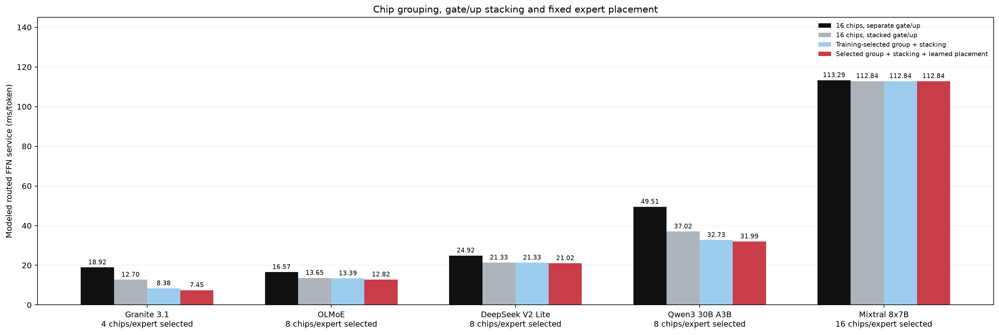
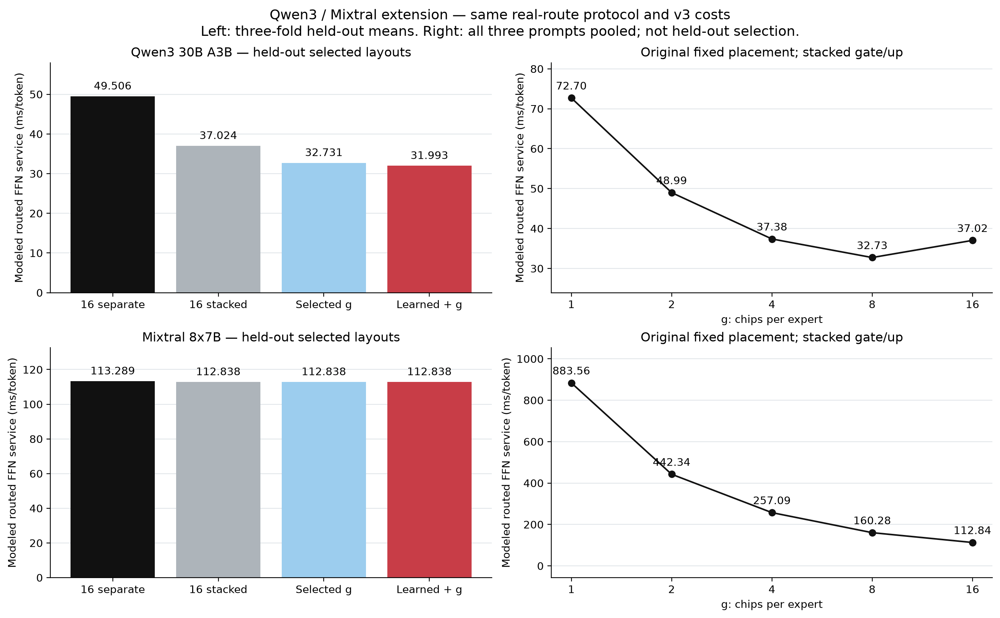
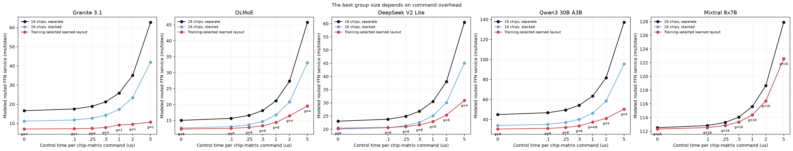

# MoE routed FFN 的 AiF 分組與放置實驗

更新日期：**2026-10-27**。本次補測 Qwen3 與 Mixtral；Granite、OLMoE、DeepSeek 沿用 2026-10-19 保存的結果。原三模型數值已逐項核對未變，原始報告與圖表封存在 [archive/2026-10-19](archive/2026-10-19/)。

全部比較使用相同 v3 controller-fanout 計時模型、三組 plain-text prompts、各 32 次 greedy decode。每折只用兩組 prompts 學習固定排列與選擇 g／串接，第三組保留驗證；報告三折保留平均。

## 五模型主要結果

單位：**routed FFN 服務時間，ms／decoded token；越低越好**。降低幅度比較「16-chip、gate/up 已串接」基準。

| 模型 | 16-chip 分開 | 16-chip 串接 | 選 g＋串接，原排列 | 選 g＋串接＋學習排列 | 學習配置 g | 較已串接基準降低 |
| --- | ---: | ---: | ---: | ---: | --- | ---: |
| Granite 3.1 1B A400M | 18.920 | 12.703 | 8.378 | **7.452** | 4 | 41.34% |
| OLMoE 1B 7B | 16.568 | 13.648 | 13.390 | **12.824** | 8 | 6.04% |
| DeepSeek V2 Lite | 24.917 | 21.333 | 21.333 | **21.015** | 8 | 1.49% |
| Qwen3 30B A3B | 49.506 | 37.024 | 32.731 | **31.993** | 8 | 13.59% |
| Mixtral 8x7B | 113.289 | 112.838 | 112.838 | **112.838** | 16 | 0.00% |

DeepSeek 的原排列選 g=16，學習排列選 g=8；其差異同時包含 g 與排列，不能完全歸給同一 g 下的 placement 交換。

## 補測得到的差異

**Qwen3：三折皆選 g=8。** 16-chip 已串接為 37.024 ms，選分組後 32.731 ms，加學習排列後 31.993 ms，較已串接基準降低 13.59%。它的單 projection 是 1.5 MiB，補上原有 0.5／2／2.75 MiB 之間的尺寸。

**Mixtral：三折皆選 g=16，學習排列沒有額外改善。** 已串接與訓練選配置均為 112.838 ms。單 projection 為 56 MiB；即使分到 16 chips，每 chip 仍有 3.5 MiB、56 個四-plane read waves，已是長讀取。每次只選 2 個 experts，較小的 group 也會降低可用的 chip 並行度。

上述是不同真實模型的觀察，同時包含 expert 大小、top-k、層數與 routing 差異，並非只改尺寸的控制實驗。

右側 g 掃描固定原排列、gate/up 已串接，使用三組 prompts 合併平均；與左側訓練選配置後的保留驗證程序不同。

| 原排列已串接 | g=1 | g=2 | g=4 | g=8 | g=16 |
| --- | ---: | ---: | ---: | ---: | ---: |
| Qwen3 30B A3B | 72.698 | 48.990 | 37.384 | 32.731 | 37.024 |
| Mixtral 8x7B | 883.564 | 442.343 | 257.091 | 160.284 | 112.838 |

## 模型尺寸與轉檔驗證

| 模型 | H × I | Experts／top-k | Routed 層數 | INT8／projection | Routing records |
| --- | --- | --- | ---: | ---: | ---: |
| Granite 3.1 1B A400M | 1024 × 512 | 32／8 | 24 | 0.5 MiB | 2,304 |
| OLMoE 1B 7B | 2048 × 1024 | 64／8 | 16 | 2 MiB | 1,536 |
| DeepSeek V2 Lite | 2048 × 1408 | 64／6 | 26 | 2.75 MiB | 2,496 |
| Qwen3 30B A3B | 2048 × 768 | 128／8 | 48 | 1.5 MiB | 4,608 |
| Mixtral 8x7B | 4096 × 14336 | 8／2 | 32 | 56 MiB | 3,072 |

Qwen3 的既有 FP8 checkpoint 依 128×128 block scales 解量化後轉為 Q8_0；Mixtral 由既有 BF16 轉為 Q8_0。兩者各完成 13 組獨立權重抽查，最大相對 L2 誤差為 0.6873%／0.5693%，所有樣本皆為有限值。這是轉檔檢查，不是模型品質評測。AiF 時序仍使用 INT8，不能拿 GGUF 檔案 bytes 當作 INT8 權重大小。

Mixtral 首次轉檔的前綴空白 metadata 與來源 tokenizer 不符。已修正唯一的一個 header byte、重算完整 hash，並重新擷取全部 routing。修正後兩模型的三組 prompt token IDs 均與本機 Hugging Face tokenizer 相同，tracing 開關的生成文字逐 byte 相同。原始來源與 pinned llama.cpp 未修改；詳見 [tokenizer 與 tracing 紀錄](../docs/llama_trace.md#mixtral-tokenizer-metadata-correction)。

## 命令與傳輸成本

沿用 0.25 μs／chip-block command、2 μs／host phase、輸入 1 byte／輸出 4 bytes 每元素。這些是展示假設，未經實體 AiF 校準。每份 logical input 經 PCIe 傳一次，再由 controller 跨 channels 複製；PCIe／channel 上限為 8／2 GB/s。

| 模型與配置 | Flash | Chip commands | Host | 輸入 | 輸出 | 合計 |
| --- | ---: | ---: | ---: | ---: | ---: | ---: |
| Qwen3 30B A3B 16-chip 已串接 | 32.6784 | 3.0720 | 0.1920 | 0.3932 | 0.6881 | 37.0237 |
| Qwen3 30B A3B 訓練選學習配置 | 29.3307 | 1.5360 | 0.1920 | 0.2456 | 0.6881 | 31.9925 |
| Mixtral 8x7B 16-chip 已串接 | 110.1005 | 0.5120 | 0.1280 | 1.0486 | 1.0486 | 112.8376 |
| Mixtral 8x7B 訓練選學習配置 | 110.1005 | 0.5120 | 0.1280 | 1.0486 | 1.0486 | 112.8376 |

分項單位同為 ms/token。

## 虛擬地址與容量

| 新增模型 | 有用 routed INT8 | 保留 LSB 空間 | 對應 raw TLC cells |
| --- | ---: | ---: | ---: |
| Qwen3 30B A3B | 27 GiB | 27.5625 GiB | 82.6875 GiB |
| Mixtral 8x7B | 42 GiB | 48 GiB | 144 GiB |

容量取各折學習配置的最大值，包含所有 routed experts。已檢查 row 覆蓋、位址不重疊、pages、cold runs 與 bytes 守恆。地址為 metadata 計畫，未把模型權重寫進約 2 GB 的 replay namespace；raw TLC 以保留 LSB 的三倍計算，未含 ECC、備用 blocks 或其他模型權重。

## 重播證據與解讀範圍

本次新增 **32 組 v3 workloads、222,720 個 NVMe commands**，全部經 QEMU/KVM guest 的 NVMeVirt queue。連同原三模型，已保存 **80 組 v3、406,464 個命令**；所有版本合計 **132 組、1,036,224 個命令**。已重新解析全部證據，逐 chip bytes/pages/read rounds/cold reads/service，以及控制、host、PCIe／channel 分項均與預期吻合；實際 ioctl wall time 另存。

這證明 Python 與 kernel 的模型實作一致，並非獨立的實體 AiF 效能量測。服務時間排除 attention、router、activation/combine、shared/dense FFN、GC、DRAM cache 與跨 host/SSD tensor overlap，不能換算完整模型 tokens/s。三個短 prompts 是可重現的先導實驗，不保證其他流量的最佳 g 相同。

VM 已正常關閉。原始模型與所有大型 artifacts 保留於 NFS；模型、程式與 routing hashes 見 [experiment_manifest.json](experiment_manifest.json)，重播逐項證據見 [nvmevirt_validation.json](nvmevirt_validation.json)，五模型數字見 [summary.csv](summary.csv)，新增模型分項見 [additional_models.json](additional_models.json)。
