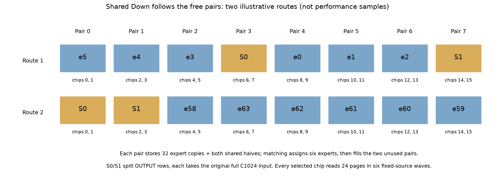
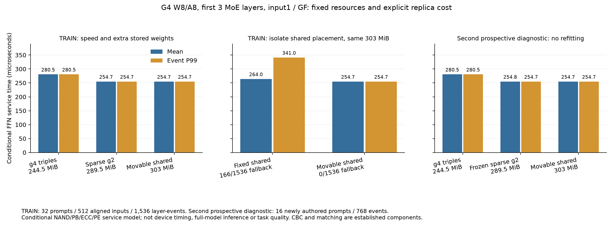
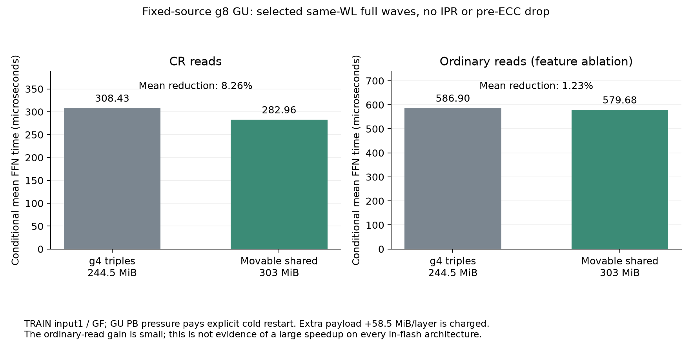
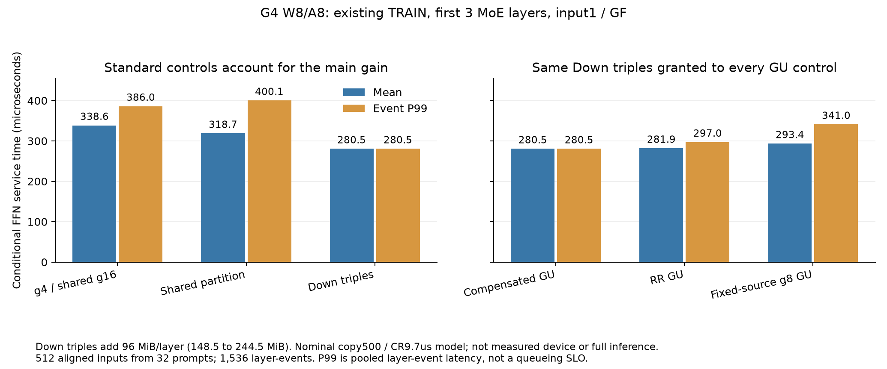

# Expert 實體配置：CR／獨立 plane 讀取的第三輪研究

本輪依使用者指示恢復實驗，使用三個 `gpt-6.1-sol`、`xhigh` 子代理。研究範圍是現有運算能力下的配置、完整列分片、實體副本與派送，不改模型數值。使用者提出的「同 block 跳 WL 仍可 CR、同步 read wave 可讓各 plane 選不同 WL」作為本輪前提；沒有將它擴張為非同步 plane 執行。

**目前最值得繼續的候選是「讓 shared Down 隨 routed experts 的配置移到空閒 chip pair」，並用既有 CBC 保證任意 top6 無衝突。** 已完成實體配置、完整 FFN、同容量 ablation、容量下界、兩批新路由與獨立排程檢查。這比只學 expert 排列多了一個可證明的配置／派送性質；仍未建立可宣稱投稿突破的新貢獻。CBC、增廣路徑 matching、replication 與不同 GU／Down 分片都有先例，不能重新命名成新演算法。一般 IR 能表達這個程式，也不等於既有獨立 mapper 已找到相同可執行配置。詳見 [貢獻審查](contribution-review/review.md) 與 [新增一手文獻界線](joint-shared-prior-notes.md)。

## 結果應如何閱讀

效能數字全部是 **固定 W8/A8 參考、路由驅動的條件式 FFN 服務模型**。主要完整 FFN 重播使用 G4 前三個 MoE layers、32 個既有 TRAIN prompts ×16 decode inputs；每個配置共有 1,536 layer-events，但只有 512 個對齊 inputs、32 個 prompts。另外各16個新自編 prompts 的兩批診斷，各有768 events／256個對齊 inputs。第一批暴露失敗後才提出新配置，因此新配置在第一批上的結果標為 diagnostic reuse；第二批在配置、程式、比較規則全部凍結後才收集。這些都不是代表性 benchmark、完整模型推論速度、任務品質或實體 AiF 測量，沒有打開舊 heldout。

同一個完整 FFN 排程器計入 host submission、command、PCIe、八個雙 chip ONFI channels、十六個 chip、有限 PB、ECC 與輸出 drain；private Down 等自己全部 GU 到 host、完整 activation/A8、完整私有 input upload。不同 expert 的 Down input 沒有被當作共同輸入。各比較使用相同資源、相同可行性政策及相同容量上限。

## 最新候選：shared 跟隨空閒 pair

把16個 chips 分成八個兩-chip groups。每個 expert 的完整 Down 存在四個 groups；64個支持集互異，每 group32個 experts。將 shared Down 的輸出 rows 切成 `[0,768)`、`[768,1536)` 兩份，每份仍使用原來完整的 C1024 input，並複製到所有 groups。路由出現後，以標準 matching 把六個 experts 派到六個不同 groups，再把兩個 shared halves 派到剩下兩個 groups。這不切私有輸入、不改運算值、不增加 MAC contexts。

每個 selected chip 恰好一個 native Down job：routed 為 R768×C512，shared half 為 R384×C1024；均24pages、六個完整 same-WL waves、固定0123、不需 IPR、dummy 或 ECC 前丟頁。標準 degree4 CBC 的 Hall 證書涵蓋全部74,974,368種 top6，而不是只對 TRAIN 路由成立。八個 groups 每個常駐34 jobs，Down204WL加最高 GU128WL=332/384；完整布局使用32個 chip-blocks。

下表為 conditional common GU、input1、GF 的既有 TRAIN 結果。後兩列的有用 payload 都是303MiB，實體地址也完全相同。

| 配置 | 平均 µs | event P99 µs | matching fallback | useful payload MiB/layer |
|---|---:|---:|---:|---:|
| 標準 g4 routed Down 三副本、shared 專用四 chips | 280.526000 | 280.526 | 0 | 244.5 |
| 六個 g2 routed groups、稀疏副本、shared 專用四 chips | 254.712000 | 254.712 | 0/1536（僅此 TRAIN） | 289.5 |
| 八-pair degree4，同一303MiB布局但 shared 固定 pair6／7 | 263.970570 | 340.966 | 166/1536 | 303 |
| 八-pair degree4，shared 派到兩個空閒 pairs | 254.712000 | 254.712 | 任意 top6 保證無衝突 | 303 |

**只隔離 shared 派送這個因素，同容量平均改善3.507%、event P99改善25.297%、三層對齊服務和P99改善18.330%。** 候選在此 ablation 的166個 cap2 cases 更快、1370個相等。RR／native g8另有少量固定方案更快的事件，全部保留，不能說所有 GU、所有 query 都單調改善。這是固定同一份布局的 ablation，沒有宣稱該固定 shared 布局已是所有可學配置的平均最優值。

相對較低容量的 g4 三副本，總平均改善9.202%，但多58.5MiB；這個差異混合了 shard geometry、CBC 與 shared mobility，不能全歸給新 component。相對前一版 sparse g2 多13.5MiB，主要換到任意 top6 保證，而不是 TRAIN 平均更快。Useful payload、真正常駐 pages 與 block reservation 分別報告：sparse g2／g4 triples 的可行 compact witness 為28個非空 chip-blocks，joint8為32個，共同比較上限都是32個。

目前不需 IPR／可程式 source／drop 的 g8 GU 路徑，TRAIN 平均由308.431521降到282.957484µs；ordinary-read feature ablation 由586.895818降到579.681781µs。前者改善8.259%，後者僅1.229%，兩者皆要多58.5MiB。不能因此宣稱所有 in-flash 架構都有大幅改善。

第一批新診斷發現 sparse g2 的 TRAIN 配置3/768次fallback，IDslot11/768，後者event P99退步21.37%。Joint8在該批重用診斷修掉fallback。第二批在新配置與比較程式凍結後，完整保留16個新 prompts、16 profiles；sparse g2 出現1次fallback，新配置為0，candidate總平均仍比g4triples改善9.202%，但比sparseg2平均僅改善0.044%、event P99相等。RR對sparseg2另有32個較慢事件，完整保留。詳見 [第二批協定與完整結果](second-prospective-routes/README.md)。任意 top6 的組合保證由 Hall 證書支持；有限樣本的 FFN 數字不能取代實體硬體與數值驗證。

完整證據與重現入口：

- [544 resident jobs、地址／row coverage／Hall／有限 PB 驗證與 API](eight-pair-cbc-degree4/README.md)。
- [Joint 完整 FFN、TRAIN12與diagnostic reuse8個profiles](joint-shared-full-ffn/README.md)。
- [同303MiB、同地址的 fixed-shared控制](joint-shared-fixed-capacity-control/report.md)；48個full traces另有 [逐 node獨立 scalar receipt](joint-shared-fixed-capacity-control/exact_scalar_receipt.md)。
- [Native／第一批prospective／joint共128份 saved traces的獨立稽核](joint-shared-full-ffn-independent/README.md)。這不是全部query的獨立重播。
- [第二批52個 saved代表的獨立重放](second-prospective-routes/verification/report.json)：188,844 nodes起迄／makespan與資源／FIFO／resident綁定通過；沒有把全部768queries稱為獨立重播。
- [Down-only89.94µs條件下界](g2-availability-headroom/stage-certificate/report.md)，不含GU／command／input／output，不是完整FFN最優證明。
- [固定24page full-copy／八pair family的容量證書](g2-availability-headroom/joint8-capacity-certificate/report.md)：最大常駐jobs至少34，33不可能。GU186WL加Down204WL=390>384，不能與先前GU雙副本方案直接共存。此證書不排除 variable rows／partial copies 等其他ABI，也不證明303MiB為總storage最小。
- [第二個模型shape的kernel envelope](second-shape-native-envelope/README.md)：DeepSeek兩-chip shard22waves在strict500 CR下無效，需coldreset；尚未得到第二模型完整FFN收益。

## 前序實驗與標準強控制

下表為 input1、GF 的每 layer-event 平均與經驗 P99；payload 是一層的有用係數，不能與 block reservation 混用。

| 配置 | 平均 µs | event P99 µs | payload MiB/layer |
|---|---:|---:|---:|
| Common GU；learned g4 routed Down；shared Down g16 | 338.596219 | 385.962 | 148.5 |
| 同 GU；routed Down 使用三個 g4 groups；shared Down 專用 g4 | 318.719906 | 400.106 | 148.5 |
| 同 GU；三個 routed groups 各有完整 Down 副本；shared 專用 g4 | 280.526000 | 280.526 | 244.5 |
| 普通 RR GU，也使用上述相同 Down 三副本 | 281.891182 | 296.966 | 244.5 |
| 固定 source 的 g8 GU，也使用上述相同 Down 三副本 | 293.431521 | 340.966 | 244.5 |

第一列以前仍有 g16 Down 控制：相同 GU 從 427.092 降到338.596 µs，約20.72%；RR 同樣得到20.65%。因此不能把這部分報成新 shared layout 的收益。

第二列比第一列平均改善5.870%，但 event P99 退步3.665%；三層對齊服務和的 P99 則改善2.189%。第三列比第二列平均改善11.9835%、event P99 改善29.887%，全部1,536個配對沒有退步。**副本增加96 MiB/layer，約為原 payload 的64.65%。** 與同樣三副本的 RR 比較，特殊 GU 配置的平均優勢僅0.4843%，且有378個事件較慢、533個相等。主要收益是標準 Down replication，不能算成 stencil 的額外收益。

[可匯出的 PDF](overview.pdf) 與 [數值、來源雜湊](overview.json) 由 `scripts/research_20261102_cr_round3_overview.py` 產生；這是後設描述，不做新配置選擇。

完整比較、所有 input1／4、GF／DF、配對退步與容量帳在：

- [完整 FFN 初輪與 private Down 幾何](full-ffn/README.md)。
- [Shared Down 分區的完整配對結果](down-headroom/final-run/paired_report.md) 與 [相同 priority／static grouping／容量控制](down-headroom/final-run/controls_addendum.md)。
- [Down 三副本：36個完整配置、來源與重現 API](down-replica-full-ffn/README.md)。
- [新增180份代表 trace 的獨立稽核](final-extensions-independent/report.md)：662,220 nodes、1,083,960 edges、8,640 jobs 的每個起迄時間完全吻合；另驗證資料依賴、rows／bytes、owner 與連續 drain 的128B FIFO。它沒有獨立重播每個 TRAIN query。

## 跨 WL 思路帶來的能力與限制

G4 每個 chip 上，一個 routed GU 有6 pages，共同 shared GU 有12 pages。配置 routed 每個 expert 的 plane counts 為 `(2,2,1,1)`、shared 為 `(0,0,6,6)`，任意 top6 都有 `6×(2,2,1,1)+(0,0,6,6)=(12,12,12,12)`。這讓48個有用 pages 達到12-wave工作量下界。全部64 experts 加 shared 的 resident counts 為 `(128,128,70,70)`，可放進一個192-WL block。

但 wave 工作量不等於可執行時序。1536-byte 完整 dot 與16KiB page 的共同邊界是3 pages／32 rows；不能在尚未完成的 row 中切換 expert。已建立正確的 macro stream、實際地址與整數／scale 位元檢查，見 [數值驗證](numeric/report.md)。比較了1,029組邊界／隨機 routes 的8,429,568個 row outputs，以及7組既有真實 checkpoint W8 fixture；均無不一致。這不等同原 GGUF 品質或實體 PE 驗證。

原 stencil 的12-wave程式需要可改變的 PB→ECC plane 順序。固定0123時，不只12 waves不可行：在該完整 macro／owner-order family 中，exact DP 最少需要18 waves，strict500為195.960 µs，輸給普通 RR 所有七種 phase composition。這個負結果已保存，不能以一張漂亮的 plane-count 圖取代它。見 [固定 source lowering／exact DP／反例](fixed-source-lowering/report.md)。

固定 cadence9.7 µs、ECC6.4 GB/s、兩個 weight latches 的模型也有 PB 壓力：12個 full waves 在 copy320ns可行、321ns不可行。copy500的原12-wave stream不可行；加一個有明確實讀成本的 split wave 後可行。只把 cadence 改為9.736 µs也能消除該特定 hazard；此值仍會四捨五入成9.7 µs。因此不能把 buffer mismatch 或 overfetch shaping 當作穩健且獨有的新突破。

- [有限 PB 模型與負例](pipeline/report.md)、[獨立 recurrence 稽核](pipeline-independent/report.md)。
- [有限 full-wave burst 下界](burst-bound/report.md)、[cadence 否證控制](pipeline/cadence/report.md)。
- [嚴格固定循環 source 的一副本12-wave阻礙](fixed-scan-contract/report.md)。這不是對所有可遮罩／可重排硬體的否定。

## 以容量取代可程式 plane 順序

已封存的補充實驗比較兩個相同 +87 MiB GU payload 的方案：

1. 每 expert 提供兩種 GU page phase；只有三個 expert 固定 phase0、三個固定 phase2，其餘58個各有兩份。任意 top6 都可選成3／3個 phases，交替後得到固定0123的12個 full useful waves。
2. **標準 g8 whole-GU group replicas**：兩個8-chip groups 各保留61個 experts，各選3個，再加共同 shared；同樣有12個 full useful waves。這個控制有相同副本量與 plane occupancy，whole-wave模式甚至只需 same-WL reads，不需要 IPR。

兩者 GU 都為每 plane186WL；shared Down 的6WL可緊接在186–191，routed Down 三副本占另外一個 block。整層 useful payload331.5 MiB，可行 placement為28個 chip-blocks，共同比較上限32個。+87 MiB不能因放進既有 block holes 就記成零儲存成本。

58-copy的選擇保證是已知 two-server、capacity3 combinatorial batch code 特例，不是新定理。在固定兩種 phase／每 phase3個 expert／完整6-page copies的範圍內，若任一 phase 有四個以上 expert 無法存取，就存在 top6不能取到三個該 phase expert，因此最多各三個 single-phase experts。這不是任意 layout 的副本最少值。

結果是兩者在完整 FFN 的TRAIN64 screen完全相等，也等於先前可程式 source的candidate+Down三副本280.526µs；標準 whole-group replica控制已消除 phase-specific優勢，因此沒有再擴512。+87MiB換來能力需求較少，但這不是新的placement優勢。見 [完整screen](gu-phase-replica-full-ffn/screen/README.md) 與 [獨立 count／Hall／真實 W8 byte-stream 證據](gu-phase-replica-independent/report.md)。

## 其他已排除的方向

| 方向 | 已取得的證據 | 本輪決定 |
|---|---|---|
| 固定原 GU、g4 band 粒度與 shared g16 的更多 Down 副本 | 即使 unlimited-fast copies，input1／4只餘4.26／4.47%樂觀 headroom；標準完整 Down group replicas可匹配 | 不在這個固定 frame展開；不能外推到改 shared geometry後 |
| 把原 common GU 等分成兩個 native jobs | compute-only必要均值355.289 µs，已高於當前338.596 µs；仍未計新 command／input | 排除這個等分切法，不否定異質支持範圍 |
| DeepSeek universal44-wave shared補位 | 最低最大 resident footprint392頁，超過兩 blocks的384；不能把全域 page LB當實際同 block程式 | 建立容量證書 |
| DeepSeek 兩 block packing／TRAIN page search | 普通 RR45.28 waves；generic約44.40，但P99變差，NAND/ECC必要界亦無優勢 | 不擴 full FFN，不宣稱延遲收益 |

證據：[固定 frame replica／切分上界](down-replica-headroom/report.md)、[改 shared g4後的重新審計](down-replica-headroom/shared-g4-standard-triples/report.md)、[容量／平衡計數證書](capacity-balance-bound/report.md)、[DeepSeek block-aware強控制與全部排程獨立重播](deep-block-headroom/README.md)。所有小範圍停止規則只是研究資源分配，不是一般不可能定理。

## 硬體、數值與新穎性的未決事項

現有硬體主張仍需確認 PB 的 copy／overwrite 時序、ECC／PE實際吞吐與輸出數值、native sparse同 block控制、output FIFO大小，以及 inactive page是否可在ECC前丟棄。programmable PB source只用在明列條件的分支；fixed-source對照不可偷用它。published28 µs含precharge／evaluation／discharge，其 phase切分未量測；模型將總量保守放在首頁可用之前，這不是電路時序證明。

三副本主結果在宣告的 page-output burst模型下需要128B FIFO；64B不可行。初輪部分 separate／legacy input4、DF controls需要256B，不能將全部控制概稱128B都過。完整 FFN v1 recipe cache漏記block的反例、以及q4誤標W8的metadata errata均保留且有界定影響，見 [metadata erratum](pipeline/metadata_erratum.json)、[cache-key erratum](full-ffn-independent/erratum.recipe-cache-block.json)。

查讀的一手來源包括 [AiF](https://doi.org/10.1145/3695053.3731073)、[Stratum](https://arxiv.org/html/2510.05245v1#S4.SS1)、[SLIM v1](https://arxiv.org/html/2507.09201v1#S6.SS1)、[HDA-MoE](https://arxiv.org/html/2609.08682v1#S5.SS2)及其官方 allocation code；來源範圍與雜湊在 [prior audit](asymmetric-down-prior/notes.md)。共同輸入攤薄、GU／Down不同切分、packing與資源分區已有直接先例。本輪未證明新的 solver、CBC、replicated declustering或新硬體。

若要走向投稿，應聚焦能被後端接受或拒絕的完整列 lowering／證書，以及 shared／private jobs 的可移動配置所帶來的容量與尾延遲保證。已補同容量比較與兩批新診斷；仍缺實際硬體 contract、可重用而非手工 G4 pass、第二個非手工 shape的完整FFN證據，以及對已知CBC與一般row mapper的充分新穎性界定。新自編診斷不是任務品質或外部benchmark，現有證據尚不足以直接宣稱投稿突破。

根協定見 [experiment_plan.frozen.json](experiment_plan.frozen.json)。各後續實驗均另存source／protocol／selection receipts；後設總結不改這些封存實驗。

新增圖表的 [PDF／數值與來源雜湊](joint-figures.json) 由 `scripts/research_20261102_cr_joint_figures.py` 描述性產生，未用來挑配置。

本次補充的 [封存依賴核對與證據索引](checkpoint.receipt.json) 重驗12個active protocols、218個不重複依賴，無hash衝突或變動；已失敗的native v1另以erratum及原source copy保留，沒有當成有效結果。可直接匯出 [最新效能圖PDF](joint-overview.pdf) 與 [配置示意PDF](joint-layout.pdf)。
