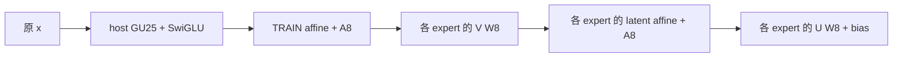

# 第二輪方法與已完成的 VALID 診斷

本文件保存正式新 TEST 開啟前的設計與診斷；最終 TEST 數字另見本目錄的 `report.zh.md`。
使用者後續允許 GPU，因此 L40S 用於短訓及分解；正式品質與所有 canonical VALID 都在 CPU 執行。
兩個 subagents 分別負責 fitting／controls 與數值／runtime，模型與大型資料放 NFS。

## 資料與數值契約

- 模型：DeepSeek-V2-Lite-Chat，原 Q8_0 GGUF；attention／router 等保留 GGUF 路徑，FFN 用 canonical W8A8 override。
  原生參考是這個明確的混合契約，不能當作 BF16 模型或未 override 的 GGUF 品質。
- pinned llama.cpp：`927dada6c`。W8／A8 使用 F32 maxabs/127、ties-away rounding、[-127,127]；
  integer dot 後保留明定的 F32 rescale 與獨立 bias，加上 pinned native SwiGLU。
  離線 FP64 BLAS 只乘整數 codes，再用 frozen C++ 重現 F32 邊界。
- 原六 expert 的主診斷維持 TRAIN600／VALID200、16 input tokens。
  600 個 TRAIN paragraphs 來自321篇文章；β=.99 時六 expert 的 row-weight N_eff 約222–545，不能把所有 token 當獨立文章。
- 擴充 captures 上限64 tokens；不足64者保留真實長度，沒有 padding／複製。
  TRAIN37,845 rows、calibration-VALID12,597 rows，raw layers1／13／26 全64 experts 的 native targets 已完成。
  已知六 expert 共619,831,296個 target floats 與 capture 逐 bit 相同。
- 新品質資料是 pinned WikiText103 publisher TRAIN revision `b08601e04326c79dfdd32d625aee71d232d685c3`。
  排除全部舊 WikiText2 三個來源 split 的742個 article titles，以 input-only hash 選每篇一段：
  新 quality-VALID200篇、TEST1000篇，文章與 prefix63 均不與舊實驗重複。
  這是實驗 article-held-out split，不能稱官方 WikiText103 TEST、標準串接 PPL 或 pretraining-unseen。

## 原 native shared-z：改善量化後仍沒有足夠增量

依 `1108_2_spec.txt`，先比較同步優化的 raw x、full shared z、raw＋128／256／512個 shared features。
兩方都使用 TRAIN affine equalization，runtime 先 transform 再 whole-vector A8；直接擬合實際 QDQ features，
四種 β=0/.5/.9/.99、ridge λ=1/3/10，以及 TRAIN actual-quantized bias 校準。

| Layer／expert | 最佳 raw NMSE | full shared NMSE | hybrid128／256 最佳相對改善 |
|---|---:|---:|---:|
| 1／14 | 0.81799 | 0.86845 | −0.13% |
| 1／40 | 0.67547 | 0.70439 | 0.18% |
| 13／10 | 0.81207 | 0.84618 | 0.46% |
| 13／56 | 0.83948 | 0.86386 | 0.05% |
| 26／0 | 0.71282 | 0.75987 | 2.89% |
| 26／1 | 0.13274 | 0.16307 | 1.33% |

full shared 六個都輸給 raw。早層 hybrid 改善不到0.5%，沒有達到多 expert、至少一個非末層約10%的投入門檻。
最佳 β 多為.5；只比較0與.99會漏掉較強的 raw 控制。

進一步以3-fold **article-grouped TRAIN OOF** 選 residual coordinates，分別擬合 F~x 與 z~x。
固定 ridge1 時，L26／e1 曾出現14–19%改善；將 nuisance z~x 的 ridge降至.01／.001後，只剩約3.5–5%。
這表示先前殘差含有 ridge shrinkage 留下的線性訊號，不能全部稱作新增非線性資訊。

再凍結最強 deployed raw，另擬合小 B、重新量化與校準，保留 B=0 concat 編碼控制。
最後128／256 residual 的最佳相對改善六點約為0.04%、0.07%、0.68%、0.20%、0.52%、2.22%。
原 native-shared 分支仍未達投入門檻；這不代表所有其他 nonlinear bases 都無效。
原 raw是獨立、hash不變的fallback；候選本身fold成單一concat head後會重新row-W8與whole-vector A8。
B=0 concat也與原raw有小差異，已另外核對，沒有把它假設成bit-equivalent raw。
這個有界負結果不涵蓋所有多context架構，例如保持原raw encoding完全不變、另算shared residual的路徑。
完整 OOF、nuisance sensitivity 與 frozen-raw 數字見 `spec2_followup.zh.md`。

## 單一 routed GU25：局部正例，不能推成全部 experts 都有效

另外完成的64-token探索，使用各層 TRAIN routing 最熱八個 native GU作可用 pool，
每 expert 僅對 TRAIN 篩出的兩個 prototypes 完整擬合；排除 owner 後，三層 pooled prototype/raw SSE比例
為1.068／1.099／1.143，整池沒有勝過 raw。

少數早層正例值得縮小測試：layer1 的 native GU25 對 experts4／51／60，
非 BOS SSE相對 full raw2048改善約11.45%／14.34%／11.35%。補齊四 β 的公平擬合仍保留正例。
因此後續只留這**一份 GU bank**，不把可用 pool 的八份都算成部署需求，也不把 owner self 命中當跨 expert 證據。

固定 nested cohort 順序：`4,51,60,58,5,17,62,22,1,28,38,50`，測3／6／9／12個 experts。
後九個的順序使用 calibration-VALID，明確不是 TRAIN-only eligibility。
同寬 raw 控制以 parent C 的 pooled column energy gather1408個 x 座標，再重新擬合；
parent C曾用 VALID選參，所以這也屬 calibration search。

全12 dense pooled NMSE：prototype25為0.547786，raw1408約0.54147，仍是 raw略好。
種子三的優勢只能支持有限的 cross-expert 可重建性，不能泛稱12個都勝過線性。
owner25始終走 native D；若自然選中，可重用逐 bit 相同的 F32 phi，但後續 affine/A8 encoding context仍另計。

## GPU 短訓與 readout 低秩化

GU-only短訓固定 C／affine，GPU FP32 STE Adam、batch128，各64 steps，
learning rates1e-4／3e-4／1e-3，checkpoints0／16／32／64；VALID用 CPU integer-exact 重算。
最佳 pooled SSE只改善0.526%，另外兩個 learning rates 最佳停在step0，因此沒有加入 learned-GU runtime。
更新 GU本應是獨立 bank，不能再扣掉 native-owner reuse；這個短訓負結果不否定更大範圍的 joint training。

容量瓶頸改由 private C著手。用 TRAIN QDQ features 的加權 covariance G，取 `C G Cᵀ` 的 top-rank eigenvectors P，
設 `V=PᵀC`、`U=P`，實際部署順序如下：

raw 控制使用相同的兩階能力。V無 bias；latent center／gain及 final bias都由 TRAIN的實際 canonical 輸出校準。
latent A8是每個 expert 私有，不能按 shared basis 去重。原 full-C payload完全保留，沒有回寫。

| Family／rank | 全12 NMSE | 相對各自 dense SSE增幅 | SSE增幅≤5%的heads |
|---|---:|---:|---:|
| Prototype／128 | 0.560283 | 2.281% | 8／12 |
| Prototype／256 | 0.551911 | 0.753% | 12／12 |
| Prototype／512 | 0.548797 | 0.185% | 12／12 |
| Raw1408／128 | 0.556952 | 2.859% | 11／12 |
| Raw1408／256 | 0.546903 | 1.003% | 12／12 |
| Raw1408／512 | 0.542808 | 0.247% | 12／12 |

rank128的 prototype種子三 SSE增加6.36–7.99%，未過5%局部門檻；rank256增加1.75–2.35%，
因此正式 TEST前固定rank256，不在TEST後從128／512重選。
72個模型的獨立整kernel probes共1,032,192個 output floats及 V／latent affine／A8 codes/scales全部逐 bit相符。
新舊 native／dense live64-token＋AR執行器亦逐題 NLL／top1／tokens／routes一致。

## 完整模型 VALID 與低 exposure 控制

新200篇、prefix64／TF63、AR0的 subset PPL比較如下，均是選模用 VALID，尚非正式 TEST：

| 配置，固定12 experts | PPL變化 | paired article 95% CI |
|---|---:|---:|
| Dense prototype25 | +0.372% | −0.523%～+1.246% |
| Dense raw1408 | +0.324% | −0.658%～+1.248% |
| Dense raw2048 | +0.029% | −0.909%～+0.942% |
| Rank256 prototype25 | +0.786% | −0.139%～+1.694% |
| Rank256 raw1408 | +0.244% | −0.728%～+1.164% |
| Drop zero | +1.597% | +0.504%～+2.715% |
| TRAIN selected mean | +1.161% | +0.091%～+2.231% |
| TRAIN selected α² mean | +1.067% | −0.022%～+2.149% |

同時，原六 experts／prefix16 的常數控制有部分區間落在2%以內。
因此「小 PPL變化」本身不足以證明高品質 expert reconstruction；正式結果還要報替換比例及常數敏感度。
TRAIN mean／α² mean不使用 VALID targets，router weights不重新正規化。

發現並修正一項 reference 問題：prefix16與prefix64即使 tokens相同，前15個 native分數也可能不同。
舊與新執行器各自保持同shape exact；不開 FFN override 的 source GGUF也重現跨shape差異，
capture在第一個 MoE之前已出現差異。這支持差異不是新adapter造成，但尚未定位特定 attention/kernel根因。
所有比較都改用**相同 prefix／batch shape**，不以64-token參考的前15分代替16-token原生參考。
新 factor runtime 的 native arm 全部200題／12,600個位置又與既有64-token原生參考完全相同。

## 凍結的最終檢驗與成本範圍

五組各1000篇：native、dense prototype25、rank256 prototype25、rank256 raw1408、TRAIN α² mean。
每題 fresh KV、64 input tokens，評63 targets，另做最多16 token live greedy generation。
僅 rank256 prototype-vs-native為 primary：10000次 paired article bootstrap，seed20261109，
ΔNLL的95%區間上界≤log(1.02)判通過（等價relative PPL區間上界≤2%），下界>門檻判失敗，否則未定；其餘全部描述性。
沒有 dense-raw TEST arm，所以 raw壓縮前後的全模型差異只能引用 VALID，不能由此 TEST宣稱等價。

固定非線性 cohort的 coefficient-residency budget：

- Dense：40,601,984 bytes＝38.7211 MiB。
- Rank256：12×904,192 binary bytes＋48-byte rank metadata＋23,936-byte input metadata＋5,778,432-byte GU，
  共16,652,720 bytes＝15.8813 MiB，比 dense少58.99%；readout binary本身少68.82%。
- 原生 expert GU／D／全部分別5,778,432／2,891,776／8,670,208 bytes，含row scales。
- 同rank raw readout payload相同，省下的一整份 GU budget可放其他 native cache。
  factor.json內的路徑／hash provenance另列 artifact bytes，不由文字長度決定可否放一份 GU，但仍凍結所有檔案hash。

成本 primary固定全部26層 native-reference routing、nonBOS位置1..62，
使用新 quality-VALID nonBOS v2 policy；含 BOS v1僅是預先指定敏感度。
same-budget native GU／完整 expert／mixed full-GU-D及 raw-plus-native-cache placements均在 TEST前凍結。
最優性限於這三種整矩陣單位及係數byte-work，沒有宣稱page／activation-transfer／latency最優。
generation-causal與最後未使用decode分開列，actual nonlinear routing另列，不能把它們混成固定native反事實。
係數byte-work按每個 expert/token事件累加；沒有模擬 prefill跨token的矩陣重用、cacheline／page或flash佇列，
因此不能把它直接稱作prefill傳輸bytes。generation欄另列每一步的因果事件，仍不是實測IO。

此 B僅為增量 coefficient／scales／bias／metadata；共同 backbone、KV及 workspace仍需容量，
GU phi、transformed A8、private latent等特有 activation workspace亦額外佔用，尚非完整host peak量測。
若完整 canonical model的約14.72 GiB weights加KV/workspace可放host，完整native常駐是合法的零routed-flash係數讀取控制。
functional harness為數值核對仍計算native FFN，不以其 wall time宣稱壓縮部署速度，亦未實測flash、NVMeVirt或TPOT。

正式凍結receipt SHA256：`0714103fab74c6a488c72f0313b967230ea9ec4644611d17fa29b679ad576e7d`。
343個input files、283個registry／payload files及11份source snapshots在TEST前核對。
NFS根目錄：`/home/nfs_client/ericyu/expert_flash_experiment/research-2026-11-09-shared-features`。
