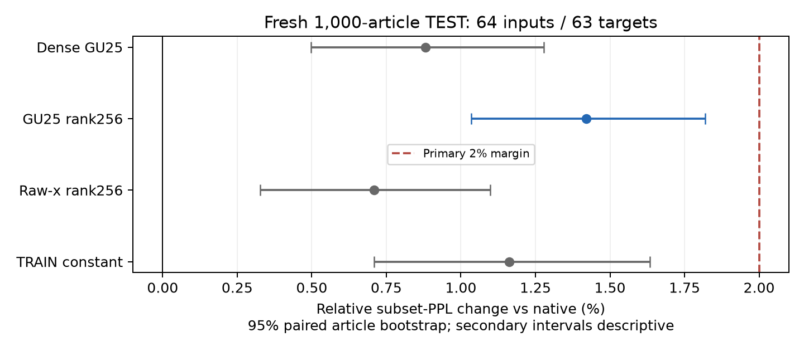
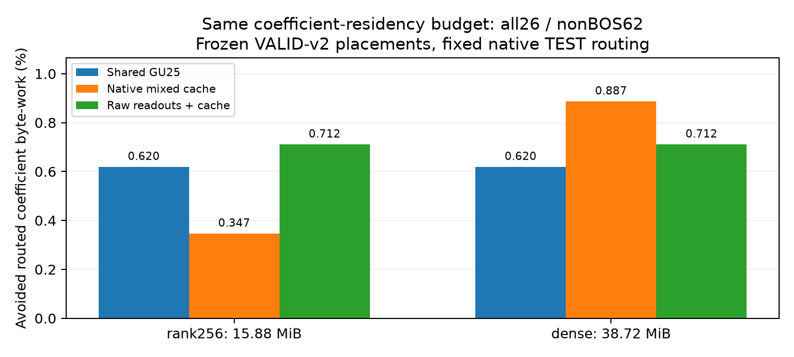

# 共享非線性第二輪：完整1000題 TEST 結果

固定單一 layer1 GU25、12個 nonowner experts、rank256 的品質 primary **通過2% subset-PPL門檻**：+1.420%，paired article 95% CI +1.035%～+1.820%。
相較 dense共享方案，係數常駐量由38.7211縮至15.8813 MiB，下降58.99%。
這個容量改善不等同非線性共享已勝過強線性控制；下方同預算比較與低 exposure 控制一併判讀。

在本次固定配置及係數成本模型下，強raw-x控制同時有較小PPL退化與較多避免工作；本輪尚不支持優先部署共享GU25。低秩化確實改善容量，但沒有證明新增非線性bank的額外價值。

## 完整模型品質

五組皆完整1000篇、每篇一prompt；64 input tokens（含BOS），每組63,000個next-token targets，另做最多16 token greedy generation、fresh KV及live routing。只有壓縮共享對原生為primary；其他區間均描述性。

| 配置 | subset PPL | 相對原生變化／95% CI | 生成全序列一致率 |
|---|---:|---|---:|
| 原生 canonical W8A8 FFN | 24.284217 | 參考 | 100% |
| Dense 共享 GU25 | 24.498423 | +0.882%／+0.497%～+1.278% | 22.20% |
| 共享 GU25＋rank256（primary） | 24.629100 | +1.420%／+1.035%～+1.820% | 22.70% |
| 同寬 raw-x＋rank256 | 24.456460 | +0.709%／+0.327%～+1.098% | 23.00% |
| TRAIN selected α² 常數 | 24.566397 | +1.162%／+0.709%～+1.633% | 19.90% |

壓縮共享相對同寬、同rank raw-x的paired PPL差異為+0.706%（+0.449%～+0.973%）；相對同basis dense為+0.533%（+0.315%～+0.752%）。兩者皆為描述性，不套primary的2%判定。

預先指定的position sensitivity也顯示BOS target的影響，以下為描述性平均ΔNLL：

| 配置 | BOS，1個target／prompt | NonBOS，62個targets／prompt |
|---|---:|---:|
| Dense 共享 GU25 | +0.038823 | +0.008298 |
| 共享 GU25＋rank256（primary） | +0.407190 | +0.007762 |
| 同寬 raw-x＋rank256 | +0.040017 | +0.006536 |
| TRAIN selected α² 常數 | +0.068582 | +0.010633 |

壓縮共享相對dense的整體PPL增加主要集中在BOS所預測的第一個target；nonBOS平均ΔNLL反而略小。這提示低秩量化對此位置敏感，不是全部位置都等幅惡化。primary仍按凍結的全63個targets判定；本輪沒有看TEST後新增BOS fallback或精確cache來改寫結果。

生成一致率是對原生 greedy tokens的一致性，並非task accuracy。此處是短prefix subset PPL，不是標準串接WikiText PPL、長上下文或pretraining-unseen能力證明。



## 同預算係數工作量

主成本scope在TEST前固定為全部26層、native-reference routing、nonBOS位置1..62，使用quality-VALID nonBOS v2所選的cache配置。下表是避免的routed coefficient byte-work比例，並非實測flash bytes。

| 係數常駐預算 | 共享方法 | 原生GU cache | 原生完整expert cache | 原生mixed cache | Raw readouts＋剩餘native cache |
|---|---:|---:|---:|---:|---:|
| 15.8813 MiB（rank256） | 0.6197% | 0.2739% | 0.2192% | 0.3471% | 0.7115% |
| 38.7211 MiB（dense） | 0.6197% | 0.8461% | 0.7668% | 0.8873% | 0.7115% |

Rank256下，raw readouts不需GU25，省出的5,778,432 bytes可另放一份原生GU；配置由VALID先選，沒有用TEST頻率重排。原生cache不改數值，因此其品質對應原生參考。
Dense預算下的dense-raw-plus-cache僅作成本控制；dense raw的品質只跑VALID，沒有新增其TEST arm。rank256 raw的品質則有完整1000題TEST，兩者不能混稱同一份品質證據。
同預算係數工作比較不包含總host peak memory；method-specific phi、transform、private latent與quant workspace仍額外佔用。



## 覆蓋率與生成階段

壓縮共享在TF63實際替換55,688／9,828,000個expert/token事件（0.5666%）。生成因果階段另替換16,194／2,485,704個事件，private latent A8 rows=16,194。
TRAIN常數控制的描述性95%區間也全部低於2%。在此低替換比例下，品質門檻本身不能單獨證明有效的expert重建，也不能把本配置的通過外推到更廣coverage。
固定native routing的預先指定generation成本與actual nonlinear routing另列如下；最後未使用decode不混入因果收益。

| scope／routing | 共享避免byte-work | 同預算mixed cache | raw＋cache，該routing反事實 |
|---|---:|---:|---:|
| TF63／fixed_native | 0.6200% | 0.3416% | 0.7104% |
| BOS／fixed_native | 0.6410% | 0.0000% | 0.6410% |
| generation_causal／fixed_native | 0.7032% | 0.2633% | 0.7541% |
| generation_causal／actual_nonlinear | 0.7009% | 0.2643% | 0.7518% |

每個scope完整GU／D／MAC／新增A8 contexts、含BOS v1敏感度、actual routing與unused decode見 `final_cost_summary.json`。actual-nonlinear欄的raw比較是套用相同routing的係數反事實，並非raw自己的生成trace。byte-work按expert/token事件累加，未模擬prefill跨token矩陣重用、page或flash queue；host coefficient MAC也不包含全部quant／affine工作。

## 方法判讀與限制

原native shared-z／小residual分支在強raw控制與article-OOF後未達機制門檻。另一個native routed GU25對三個早層experts有非BOS局部正例；擴成12個後，pooled local NMSE仍是raw略好。GPU短訓僅改善0.526%，沒有部署learned-GU。有效的工程改善是private readout的TRAIN activation-aware低秩化，同時也適用raw控制，不能把這個壓縮能力全歸功於非線性共享。

功能性harness仍計算原生FFN作核對、保留原模型權重；本輪未實測flash、NVMeVirt、TPOT或端到端加速。原生fallback的模型容量未被刪除。B只計增量係數／scales／bias／metadata，公共backbone、KV及workspace均需另外容量。若host放得下完整canonical model約14.72 GiB weights加KV/workspace，完整native常駐本身就是合法零routed-flash係數讀取控制。

模型與資料、原六experts控制、全部VALID數字、batch-shape reference修正，以及精確W8A8契約見 [方法詳解](method_details.zh.md)。

## 驗證與產物

- 正式五組各1000篇、合計5000次fresh推論；80個shards全部成功，逐題IDs／targets／EOG／生成長度／routes／replacement與private-A8計數核對。
- 343個frozen inputs在開始及結束重查，另有source snapshots與獨立audit；沒有依TEST結果改rank、eligibility、payload、cache配置或統計規則。
- 72個factor模型逾103萬output floats整kernel逐bit一致；新runtime的native arm在VALID200／12,600位置與原生64-token參考一致。

小型結果：`final_quality_summary.json`、`final_cost_summary.json`、`final_independent_audit.json`、`final-selection.frozen.json`及圖表保存在本目錄。大型模型、captures、targets、payloads、logs位於NFS研究根目錄。

原始推論命令（拒絕覆寫既有輸出）：

```bash
python scripts/research_20261109_quality_run.py \
  --plan /home/nfs_client/ericyu/expert_flash_experiment/research-2026-11-09-shared-features/final1000-plan.json
```
